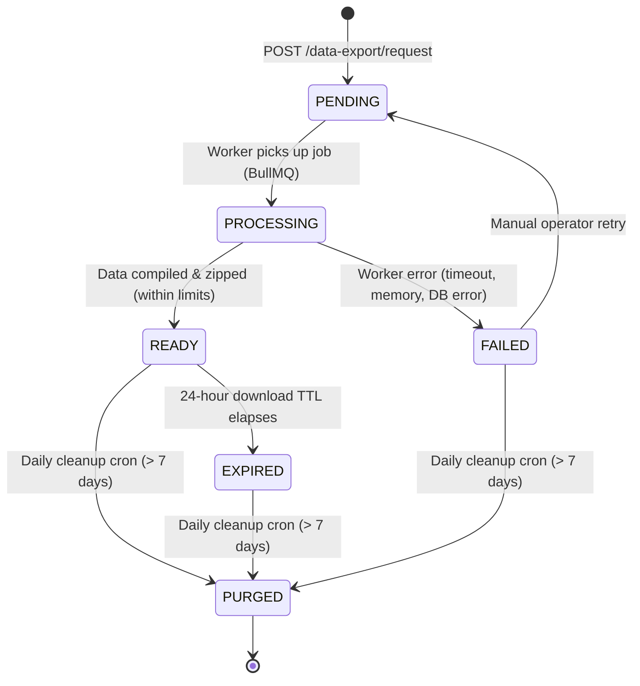
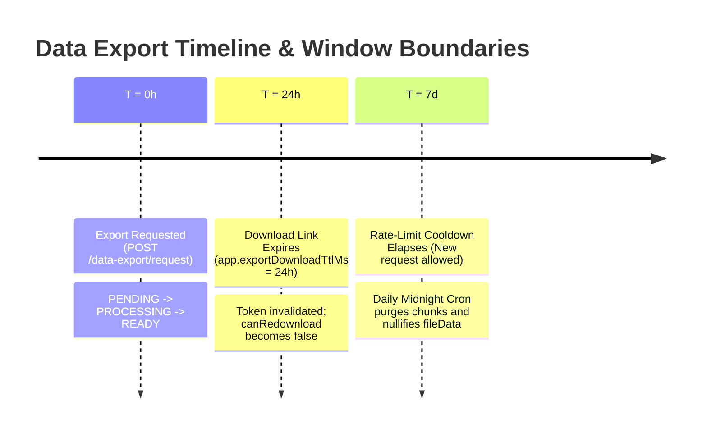

# Data Export Retention, Expiry, and Deletion Lifecycle

**Issue:** #2229  
**Scope:** Export Generation, Download Expiration, Rate Limiting, Storage Cleanup, and Error Catalogue  
**Audience:** Frontend Developers, Backend Engineers, DevOps, and Compliance/Privacy Teams  

---

## 1. Overview & Core Lifecycle States

XConfess provides GDPR/privacy data export capabilities allowing authenticated users to request an archive of their account data (confessions, messages, reactions, comments, and profile information).

Data exports undergo a strict lifecycle from queued generation to multi-tiered expiration and scheduled deletion:



### Lifecycle States

| State | Description | Stored Attributes | Accessible To User? |
| --- | --- | --- | --- |
| `PENDING` | Request received and queued into BullMQ `export-queue`. Waiting for an available worker. | `queuedAt` stamped; `userId` indexed. | Yes (visible in history & status). |
| `PROCESSING` | Job claimed by worker `export.processor.ts`. Compiling tables, generating JSON/CSV chunks, and creating ZIP archive. | `processingAt` stamped. | Yes (status indicates job in progress). |
| `READY` | Export archive is complete and stored in database/chunks. Signed download URL is available. | `completedAt` stamped; `fileData` / `export_chunks` populated; `downloadTokenHash` generated. | Yes (download link active for 24 hours). |
| `FAILED` | Compilation or archiving failed. Job is not automatically retried by BullMQ. | `failedAt` stamped; `retryCount` incremented; `lastFailureReason` recorded. | Yes (error status visible; user must wait for cooldown). |
| `EXPIRED` | Download window (24h) has elapsed or record exceeded retention cutoff (7 days). File artifacts are inaccessible or deleted. | `expiredAt` stamped; `downloadTokenHash` set to `null`; `fileData` set to `null`. | Yes (visible in history as expired). |

---

## 2. Retention Assumptions & Time Windows

The system operates under three distinct time windows to balance user convenience against data minimization and exposure risks:



### 2.1 The 24-Hour Download Expiry Window

- **Default Duration**: 24 hours from export creation (`app.exportDownloadTtlMs`, fallback `86,400,000 ms`).
- **One-Time Nonce Token**:
  - Single-file export URLs contain a cryptographically random 32-byte base64url token (`&token=<nonce>`).
  - Only the HMAC-SHA256 digest (`downloadTokenHash`) is stored in the database.
  - On the first successful download, the token is atomically consumed: `downloadTokenHash` is set to `null` and `downloadedAt` is stamped.
  - Replaying the same URL returns `410 Gone` with code `EXPORT_TOKEN_EXPIRED`.
- **Generating a Fresh Link (Re-download)**:
  - If a user needs to download again within the 24-hour window, they can call `POST /data-export/:id/redownload`.
  - If the file is still within its 24-hour TTL (`isFileAvailable`), the server issues a fresh one-time token and signed URL.
  - If the 24-hour window has elapsed, the request returns `400 Bad Request` and no new token can be minted.

### 2.2 The 7-Day User Cooldown (Rate Limiting)

- **Limit**: Exactly **1 export request per 7 days** per user account.
- **Enforcement**:
  - Checked against `createdAt > NOW() - INTERVAL '7 days'` in `requestExport()`.
  - If a request exists within the 7-day window, the endpoint throws `400 Bad Request` (`Export allowed once every 7 days.`).
- **Concurrent Active Job Guard**:
  - If a user has any export currently in `PENDING` or `PROCESSING`, a second request is rejected with `409 Conflict` (`An export is already in progress. Please wait for it to complete.`).

### 2.3 The 7-Day Scheduled Deletion (Storage Purge)

- **Retention Threshold**: 7 days (`export.retentionDays` or `EXPORT_RETENTION_DAYS`, default 7).
- **Automated Cleaner**: `DataCleanupService.purgeOldExports()` runs daily at midnight (`@Cron(CronExpression.EVERY_DAY_AT_MIDNIGHT)`).
- **Purge Actions**:
  1. Identifies all `export_requests` where `createdAt < NOW() - retentionDays` across all statuses (`PENDING`, `PROCESSING`, `READY`, `FAILED`, `EXPIRED`).
  2. Hard-deletes all associated chunk rows from `export_chunks`.
  3. Updates `export_requests`: sets `fileData = null`, `downloadTokenHash = null`, `status = 'EXPIRED'`, and `expiredAt = NOW()`.
  4. Retains metadata rows (dates, retry counts, status) for legal and compliance audit evidence.
  5. Logs an immutable audit event: `EXPORT_RETENTION_CLEANUP_COMPLETED`.

---

## 3. API Endpoints & Request Lifecycles

All endpoints except `GET /data-export/download/:id` require standard JWT authentication (`Authorization: Bearer <token>`).

### 3.1 `POST /data-export/request`
Initiates a new export job for the authenticated user.
- **Auth**: `JwtAuthGuard`
- **Success Response (201 Created)**:
  ```json
  {
    "requestId": "exp-uuid-1234",
    "status": "PENDING",
    "queuedAt": "2026-10-19T12:00:00.000Z"
  }
  ```
- **Error Responses**:
  - `400 Bad Request`: `{"message": "Export allowed once every 7 days."}`
  - `409 Conflict`: `{"message": "An export is already in progress. Please wait for it to complete."}`
  - `503 Service Unavailable`: `{"message": "Data export requires background job processing. Set ENABLE_BACKGROUND_JOBS=true and ensure Redis is available."}`

---

### 3.2 `GET /data-export/history`
Returns the user's export history (up to 20 recent requests) along with lifecycle progress and download eligibility flags.
- **Auth**: `JwtAuthGuard`
- **Response (200 OK)**:
  ```json
  {
    "latest": {
      "id": "exp-uuid-1234",
      "status": "READY",
      "createdAt": "2026-10-19T12:00:00.000Z",
      "expiresAt": 1776600000000,
      "canRedownload": true,
      "canRequestNewLink": false,
      "downloadUrl": "https://api.xconfess.app/api/data-export/download/exp-uuid-1234?userId=123&expires=...&signature=...&token=...",
      "progress": {
        "queuedAt": "2026-10-19T12:00:00.000Z",
        "processingAt": "2026-10-19T12:00:05.000Z",
        "completedAt": "2026-10-19T12:00:45.000Z",
        "failedAt": null,
        "expiredAt": null,
        "retryCount": 0,
        "lastFailureReason": null
      }
    },
    "history": [ ... ]
  }
  ```

---

### 3.3 `GET /data-export/:id/status`
Returns slim lifecycle progress for a specific export request.
- **Auth**: `JwtAuthGuard` (validates request ownership)
- **Response (200 OK)**:
  ```json
  {
    "id": "exp-uuid-1234",
    "userId": "123",
    "status": "READY",
    "progress": {
      "queuedAt": "2026-10-19T12:00:00.000Z",
      "processingAt": "2026-10-19T12:00:05.000Z",
      "completedAt": "2026-10-19T12:00:45.000Z",
      "failedAt": null,
      "expiredAt": null,
      "retryCount": 0,
      "lastFailureReason": null
    }
  }
  ```
- **Error**: `404 Not Found` if request belongs to another user or does not exist.

---

### 3.4 `POST /data-export/:id/redownload`
Mints a fresh download link for an existing `READY` export whose original token was already consumed.
- **Auth**: `JwtAuthGuard` (validates request ownership)
- **Response (200 OK)**:
  ```json
  {
    "downloadUrl": "https://api.xconfess.app/api/data-export/download/exp-uuid-1234?userId=123&expires=...&signature=...&token=..."
  }
  ```
- **Error**: `400 Bad Request` if the 24-hour TTL has elapsed (`"Secure download link is no longer available. Request a new export."`).

---

### 3.5 `GET /data-export/download/:id`
Streams the compiled ZIP file or returns chunk download links for multi-part archives.
- **Auth**: HMAC-SHA256 signature and one-time token in URL parameters.
- **Query Parameters**:
  - `userId`: Target user ID.
  - `expires`: Unix millisecond timestamp when the link expires.
  - `signature`: HMAC-SHA256 digest of `${id}:${userId}:${expires}:${token}` using `appSecret`.
  - `token`: One-time base64url random nonce.
  - `chunk`: (Optional) 0-indexed part number for multi-part exports.
- **Success (200 OK)**: Streams `application/zip` with `Content-Disposition: attachment; filename="xconfess-data-<userId>.zip"`.

---

## 4. User-Visible Error Responses

The table below lists every user-visible error returned by the data export subsystem, including the exact JSON error format and recovery actions:

| HTTP Status | Error Code / Message | Trigger Scenario | User Recovery Action |
| --- | --- | --- | --- |
| **400 Bad Request** | `Export allowed once every 7 days.` | User submitted `POST /data-export/request` while an export created in the last 7 days exists. | Wait until 7 days have elapsed since previous export creation date. |
| **400 Bad Request** | `Secure download link is no longer available. Request a new export.` | User called `POST /data-export/:id/redownload` on an export older than 24 hours. | Wait for 7-day cooldown to request a new export archive. |
| **400 Bad Request** | `File not found or expired.` | Direct file fetch where `fileData` is null or marked expired. | Export archive has been pruned; request a fresh export. |
| **401 Unauthorized** | `Invalid download link.` | Signature verification failed or URL parameters tampered with. | Use the download link as provided in `/history` without modifying URL params. |
| **404 Not Found** | `Export request not found or unauthorized` | Requesting status or file for an ID belonging to another user. | Verify the request ID belongs to the authenticated user. |
| **404 Not Found** | `Chunk not found.` | Invalid `chunk` query parameter index. | Fetch fresh chunk URLs from the export manifest. |
| **409 Conflict** | `An export is already in progress. Please wait for it to complete.` | User requested a new export while previous request is still `PENDING` or `PROCESSING`. | Wait for current job to finish compiling. |
| **410 Gone** | `EXPORT_LINK_EXPIRED` | URL `expires` timestamp is in the past. | Call `POST /data-export/:id/redownload` to get a fresh link (if within 24h). |
| **410 Gone** | `EXPORT_TOKEN_EXPIRED` | One-time token was already downloaded or replay detected. | Call `POST /data-export/:id/redownload` to generate a fresh one-time token. |
| **503 Service Unavailable** | Background jobs disabled | Server running with `ENABLE_BACKGROUND_JOBS=false`. | Platform maintenance; contact support. |

---

## 5. Operational & Forensic Procedures

### 5.1 Investigating Failed Jobs

Unlike notifications, the `export-queue` has **no automated DLQ**. Failed jobs remain in `status = 'FAILED'` with diagnostic context persisted directly on the entity:

```sql
-- List recent failed exports with failure reasons
SELECT id, "userId", "retryCount", "lastFailureReason", "failedAt", "createdAt"
FROM export_requests
WHERE status = 'FAILED'
ORDER BY "failedAt" DESC
LIMIT 20;
```

Common failure reasons:
1. `DB connection lost`: Temporary database drop during heavy query compilation.
2. `timeout`: User data archive exceeded maximum query timeout.
3. `out of memory`: In-memory archiver exceeded memory limits on large accounts.

### 5.2 Detecting and Clearing Zombie Jobs

If a worker crashes while processing a job, the record can become stuck in `PROCESSING`:

```sql
-- Find zombie jobs stuck in PROCESSING for more than 30 minutes
SELECT id, "userId", "processingAt", NOW() - "processingAt" AS elapsed
FROM export_requests
WHERE status = 'PROCESSING'
  AND "processingAt" < NOW() - INTERVAL '30 minutes';
```

**Resolution**: Mark stuck jobs as `FAILED` to free the user from the 409 Conflict duplicate guard:
```sql
UPDATE export_requests
SET status = 'FAILED',
    "failedAt" = NOW(),
    "lastFailureReason" = 'Zombie job cleared by operator'
WHERE id = '<request-id>' AND status = 'PROCESSING';
```

### 5.3 Emergency Link Revocation (Compromised URLs)

If a user inadvertently posts their signed download URL publicly:

1. **Immediate Revocation**: Delete the `export_requests` and associated `export_chunks` records:
   ```sql
   DELETE FROM export_chunks WHERE "exportRequestId" = '<request-id>';
   DELETE FROM export_requests WHERE id = '<request-id>';
   ```
2. Subsequent access attempts will immediately return `404 Not Found` or `401 Unauthorized`.
3. Check `audit_logs` for any `downloaded` events matching the request ID to verify whether unauthorized download occurred.

### 5.4 Manual Retention Cleanup Execution

Operators can trigger the cleanup sweep manually or in dry-run mode via CLI or NestJS REPL:

```typescript
// Run cleanup in dry-run mode (computes eligible rows without deleting)
const result = await dataCleanupService.runCleanup(true);
console.log(result);
// Output: { eligibleCount: 14, chunkCount: 28, dryRun: true, cutoff: "..." }

// Run live cleanup
await dataCleanupService.runCleanup(false);
```

---

## 6. Audit Logging & Compliance Evidence

All export lifecycle transitions emit structured audit entries to `audit_logs` via `AuditLogService.logExportLifecycleEvent`:

| Audit Action | Actor | When Emitted | Metadata Recorded |
| --- | --- | --- | --- |
| `request_created` | User | User submits `POST /data-export/request` | `requestId`, `status: PENDING`, `queuedAt` |
| `generation_completed` | System (`export-queue`) | Worker completes compilation | `userId`, `status: READY`, `completedAt`, chunk counts |
| `link_refreshed` | User | Download URL generated or redownloaded | `expiresAt`, `requestId` |
| `downloaded` | User | Client successfully fetches export ZIP | `userId`, `downloadedAt`, `requestId` |
| `download_failed` | System | Invalid signature, missing token, or replay | `reason: invalid_signature / invalid_or_used / not_found` |
| `token_expired` | User | Token presented after 24h retention elapsed | `expiredAt`, `reason: retention_window_elapsed` |
| `export_expired` | System | Scheduled cron sweeps stale tokens | `affectedCount`, `cutoff`, `reason: scheduled_cleanup` |
| `EXPORT_RETENTION_CLEANUP_COMPLETED` | System | Daily midnight cron purges chunks/files | `retentionDays`, `eligibleCount`, `expiredCount`, `chunkCount` |

---

## 7. Verification & Automated Testing

Contributors can verify all retention, expiration, and cooldown invariants using the test suites:

```bash
# 1. Run data export service lifecycle & token tests
npm run test --workspace=xconfess-backend -- src/data-export/data-export.service.spec.ts

# 2. Run controller routing & error response tests
npm run test --workspace=xconfess-backend -- src/data-export/data-export.controller.spec.ts

# 3. Run retention cleanup cron & chunk purge tests
npm run test --workspace=xconfess-backend -- src/data-export/data-export-cleanup.spec.ts

# 4. Run dedicated retention lifecycle regression tests
npm run test --workspace=xconfess-backend -- src/data-export/data-export-retention-lifecycle.spec.ts
```

---

## 8. Related Documentation

- [Data Export Privacy & Legal Runbook](data-export-privacy-runbook.md) — Operational response procedures for legal inquiries and GDPR requests.
- [Privacy Data-Flow Map](privacy-data-flow-map.md) — Boundary data flow including export queue and HMAC token signing.
- [Incident Runbook: Emergency Pause, DLQ, and Auth](incident-runbook.md) — Platform-wide incident escalation.
