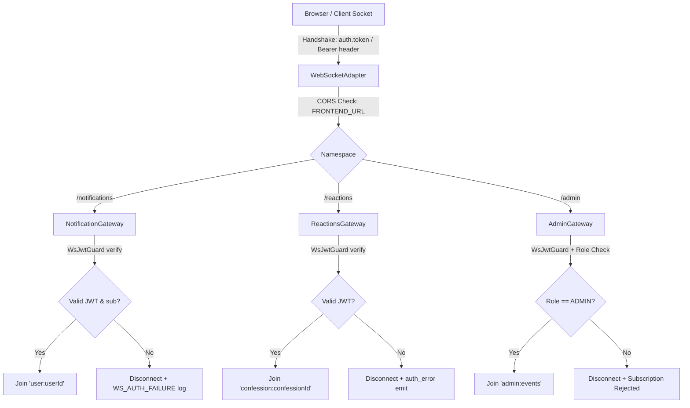

# WebSocket Event Contracts, Authorization, and Lifecycle

**Issue:** #2228  
**Scope:** Real-Time Gateways (`/notifications`, `/reactions`, `/admin`)  
**Audience:** Frontend Developers, Backend Engineers, and Security Reviewers  

---

## 1. Overview & Architecture

XConfess provides real-time event streaming powered by NestJS WebSockets and Socket.IO. The platform operates three distinct namespaces to segregate security domains and prevent unauthorized room eavesdropping:

| Namespace | Gateway Class | Purpose | Access Level | Room Isolation Pattern |
| --- | --- | --- | --- | --- |
| `/notifications` | `NotificationGateway` | Private user notifications & unread badge counts | Authenticated (`UserRole.USER` or higher) | `user:<userId>` (strictly one room per socket) |
| `/reactions` | `ReactionsGateway` | Public live reaction counters per confession | Authenticated | `confession:<confessionId>` |
| `/admin` | `AdminGateway` | Moderation queue alerts and bulk report updates | Privileged (`UserRole.ADMIN`) | `admin:events` |

### Global Connection Architecture

- **Path**: `/socket.io`
- **Supported Transports**: `websocket` (primary), `polling` (fallback/handshake)
- **CORS Origin**: Restricted strictly to the configured frontend origin via `FRONTEND_URL` / `app.frontendUrl`. Wildcards (`*`) and untrusted origins are rejected during handshake negotiation.
- **Heartbeat / Keepalive**: `pingInterval = 25000ms`, `pingTimeout = 60000ms`, `upgradeTimeout = 10000ms`.



---

## 2. Authentication & Telemetry Lifecycle

### 2.1 Handshake Authentication Mechanism

Authentication occurs during initial handshake. Clients provide a valid JSON Web Token (JWT) using either of the following mechanisms:

1. **`handshake.auth.token`** (Recommended Socket.IO pattern):
   ```javascript
   const socket = io('https://api.xconfess.app/notifications', {
     auth: { token: 'jwt.access.token' },
     transports: ['websocket', 'polling'],
   });
   ```
2. **`handshake.headers.authorization`** (Standard HTTP header):
   ```javascript
   const socket = io('https://api.xconfess.app/notifications', {
     extraHeaders: { Authorization: 'Bearer jwt.access.token' },
   });
   ```

### 2.2 PII-Free Failure Telemetry & Rejection Reasons

If token verification fails, the connection is immediately terminated. The server emits structured diagnostic telemetry that is completely scrubbed of PII (passwords, tokens, cookies, wallet addresses, and emails).

| Failure Code (`reasonCode`) | Description | Client Error Format |
| --- | --- | --- |
| `TOKEN_MISSING` | No token in `handshake.auth` or `authorization` header. | HTTP 401 / Socket disconnected |
| `TOKEN_EXPIRED` | Token expired (`exp` claim is in the past). | `auth_error` with `TOKEN_EXPIRED` |
| `TOKEN_MALFORMED` | Token failed signature verification or structural parse. | `auth_error` with `TOKEN_MALFORMED` |
| `TOKEN_INVALID_SIGNATURE` | Token signature does not match active server signing key. | `auth_error` with `TOKEN_INVALID_SIGNATURE` |
| `USER_NOT_FOUND` | Subject claim `sub` does not map to an active user record. | Socket disconnected |
| `SESSION_REVOKED` | User session revoked or blacklisted. | Socket disconnected |

Each failure log produces a non-sensitive `correlationId` (UUID v4) allowing developers to trace errors across client and server logs without exposing secrets.

---

## 3. Namespace Contracts

### 3.1 `/notifications` Gateway (`NotificationGateway`)

Private channel delivering real-time user alerts (comments, confessions, direct messages, and system notices).

#### Inbound Events (Client → Server)

##### 1. `subscribe:user-notifications`
Requests confirmation to receive events for a specific user channel.
- **Payload**:
  ```json
  {
    "userId": "12345"
  }
  ```
- **Authorization Check**: If `userId` is provided, it **must** strictly match the authenticated socket owner (`client.data.userId`). Any attempt to pass another user's ID triggers an immediate `subscription:rejected` event and the socket is forbidden from joining the room.
- **Acknowledgement**: Emits `subscription:confirmed` or `subscription:rejected`.

##### 2. `join-notifications` (Legacy Alias)
Legacy compatibility handler accepting either a string `userId` or object payload. Applies the exact same ownership verification as `subscribe:user-notifications`.

##### 3. `unsubscribe:user-notifications`
Leaves the private user room while keeping the WebSocket transport connection open.
- **Payload**: Empty object `{}`.
- **Acknowledgement**: Emits `subscription:cancelled`.

##### 4. `mark-read`
Marks a specific notification as read in the database.
- **Payload**:
  ```json
  {
    "notificationId": "notif-uuid-456"
  }
  ```
- **Acknowledgement**: Emits `notification-read`.

##### 5. `mark-all-read`
Marks all pending unread notifications for the authenticated user as read.
- **Payload**: Empty object `{}`.
- **Acknowledgement**: Emits `all-notifications-read`.

##### 6. `get-unread-count`
Fetches the current unread counter for badge synchronization.
- **Payload**: Empty object `{}`.
- **Acknowledgement**: Emits `unread-count`.

---

#### Outbound Events (Server → Client)

##### 1. `notifications:sync`
Emitted automatically upon socket connection or subscription confirmation to synchronize any unread notifications missed while offline.
- **Room**: Direct to socket.
- **Payload**:
  ```json
  {
    "notifications": [
      {
        "id": "notif-uuid-001",
        "userId": "12345",
        "type": "NEW_COMMENT",
        "title": "New Comment",
        "message": "Someone commented on your confession.",
        "isRead": false,
        "createdAt": "2026-10-19T12:00:00.000Z",
        "metadata": {
          "confessionId": "c0ffee00-1111-2222-3333-444455556666"
        }
      }
    ],
    "unreadCount": 1,
    "timestamp": "2026-10-19T12:00:00.000Z"
  }
  ```

##### 2. `new-notification`
Broadcast when a new notification is generated by background workers or services.
- **Room**: `user:<userId>` (isolated to the authenticated user).
- **Payload**:
  ```json
  {
    "id": "notif-uuid-002",
    "userId": "12345",
    "type": "NEW_MESSAGE",
    "title": "New Private Message",
    "message": "[Encrypted message]",
    "isRead": false,
    "createdAt": "2026-10-19T12:01:00.000Z",
    "metadata": {
      "threadId": "c0ffee00:a1b2c3d4"
    }
  }
  ```
  > [!IMPORTANT]
  > For end-to-end private messages, `message` is strictly constant `[Encrypted message]`. Neither ciphertext nor message plaintext travels through notification WebSockets.

##### 3. `unread-count`
Updates the count of unread notifications for navigation badges.
- **Room**: `user:<userId>`.
- **Payload**:
  ```json
  {
    "count": 2
  }
  ```

##### 4. `subscription:confirmed`
Confirms the socket was placed into its private user room.
- **Payload**:
  ```json
  {
    "channel": "user:12345",
    "timestamp": "2026-10-19T12:00:00.000Z"
  }
  ```

##### 5. `subscription:rejected`
Returned when a client attempts to subscribe to another user's room.
- **Payload**:
  ```json
  {
    "channel": "user:99999",
    "reason": "You can only subscribe to your own notification channel",
    "timestamp": "2026-10-19T12:00:00.000Z"
  }
  ```

##### 6. `subscription:cancelled`
Confirms the socket left the notification room.
- **Payload**:
  ```json
  {
    "channel": "user:12345",
    "timestamp": "2026-10-19T12:05:00.000Z"
  }
  ```

##### 7. `notification-read`
Confirms a specific notification was marked as read.
- **Payload**:
  ```json
  {
    "notificationId": "notif-uuid-456"
  }
  ```

##### 8. `all-notifications-read`
Confirms all notifications were marked as read.
- **Payload**: Empty object `{}`.

---

### 3.2 `/reactions` Gateway (`ReactionsGateway`)

Live broadcast fanout for reaction additions and removals on public confessions.

#### Connection Limits & Safeguards
- **Authentication**: JWT token required during connection handshake.
- **Per-IP Connection Cap**: Maximum 50 concurrent sockets per IP address. Exceeding sockets receive `{ message: "Maximum connections exceeded" }` and disconnect.
- **Per-Socket Rate Limit**: 30 subscription messages per 60-second window. Sockets violating the limit are dropped.

#### Inbound Events (Client → Server)

##### 1. `subscribe:confession`
Subscribes the socket to live updates for a specific confession.
- **Payload**:
  ```json
  {
    "confessionId": "c0ffee00-1111-2222-3333-444455556666"
  }
  ```
- **Validation**: `confessionId` must be a non-empty string.
- **Acknowledgement**: Emits `subscribed`.

##### 2. `unsubscribe:confession`
Unsubscribes the socket from a confession's room.
- **Payload**:
  ```json
  {
    "confessionId": "c0ffee00-1111-2222-3333-444455556666"
  }
  ```
- **Acknowledgement**: Emits `unsubscribed`.

---

#### Outbound Events (Server → Client)

##### 1. `connected`
Sent immediately upon successful handshake and IP limit verification.
- **Payload**:
  ```json
  {
    "message": "Successfully connected to reactions gateway",
    "socketId": "sock-xyz-123"
  }
  ```

##### 2. `subscribed`
- **Payload**:
  ```json
  {
    "confessionId": "c0ffee00-1111-2222-3333-444455556666",
    "message": "Subscribed to confession c0ffee00-1111-2222-3333-444455556666"
  }
  ```

##### 3. `unsubscribed`
- **Payload**:
  ```json
  {
    "confessionId": "c0ffee00-1111-2222-3333-444455556666",
    "message": "Unsubscribed from confession c0ffee00-1111-2222-3333-444455556666"
  }
  ```

##### 4. `reaction:added`
Broadcast to room `confession:<confessionId>` when any user reacts to the confession.
- **Payload**:
  ```json
  {
    "confessionId": "c0ffee00-1111-2222-3333-444455556666",
    "reactionId": "react-uuid-789",
    "userId": "12345",
    "reactionType": "HEART",
    "timestamp": "2026-10-19T12:00:00.000Z",
    "totalCount": 42
  }
  ```

##### 5. `reaction:removed`
Broadcast to room `confession:<confessionId>` when a reaction is removed.
- **Payload**:
  ```json
  {
    "confessionId": "c0ffee00-1111-2222-3333-444455556666",
    "reactionId": "react-uuid-789",
    "userId": "12345",
    "reactionType": "HEART",
    "timestamp": "2026-10-19T12:01:00.000Z",
    "totalCount": 41
  }
  ```

##### 6. `auth_error`
Emitted if JWT authentication fails in `handleConnection`.
- **Payload**:
  ```json
  {
    "reason": "TOKEN_EXPIRED",
    "correlationId": "a1b2c3d4-e5f6-7890-abcd-ef1234567890",
    "timestamp": "2026-10-19T12:00:00.000Z"
  }
  ```

---

### 3.3 `/admin` Gateway (`AdminGateway`)

Privileged stream for administrative oversight and real-time moderation alerts.

#### Authorization Controls
- **Role Requirement**: Sockets must possess a verified JWT whose subject corresponds to an active account with `UserRole.ADMIN`.
- **Guard Pipeline**: Guarded by `WsJwtGuard` and `WsRolesGuard` with `@WsRoles(UserRole.ADMIN)`.
- **Non-Admin Behavior**: Sockets without admin privileges are immediately disconnected (`disconnect(true)`).

#### Inbound Events (Client → Server)

##### 1. `subscribe:admin-events`
Subscribes the authenticated admin to platform-wide moderation events.
- **Payload**: `_data: unknown` (empty or arbitrary).
- **Acknowledgement**: Emits `subscription:confirmed` for channel `admin:events`.

##### 2. `unsubscribe:admin-events`
Unsubscribes from the admin event stream.
- **Payload**: `_data: unknown`.
- **Acknowledgement**: Emits `subscription:cancelled` for channel `admin:events`.

---

#### Outbound Events (Server → Client)

##### 1. `subscription:confirmed`
- **Payload**:
  ```json
  {
    "channel": "admin:events",
    "timestamp": "2026-10-19T12:00:00.000Z"
  }
  ```

##### 2. `subscription:cancelled`
- **Payload**:
  ```json
  {
    "channel": "admin:events",
    "timestamp": "2026-10-19T12:00:00.000Z"
  }
  ```

##### 3. `new-report`
Broadcast to `admin:events` whenever a new user report is filed against a confession or comment.
- **Payload**:
  ```json
  {
    "id": "report-uuid-001",
    "confessionId": "c0ffee00-1111-2222-3333-444455556666",
    "commentId": null,
    "reporterAnonymousUserId": "anon-uuid-888",
    "reason": "HARASSMENT",
    "status": "PENDING",
    "createdAt": "2026-10-19T12:00:00.000Z"
  }
  ```

##### 4. `report-updated`
Broadcast when a moderator updates the status of an existing report.
- **Payload**:
  ```json
  {
    "id": "report-uuid-001",
    "status": "RESOLVED",
    "moderatorId": 42,
    "resolvedAt": "2026-10-19T12:10:00.000Z"
  }
  ```

##### 5. `reports-bulk-updated`
Broadcast when multiple reports are closed or updated in batch.
- **Payload**:
  ```json
  {
    "reportIds": ["report-uuid-001", "report-uuid-002"],
    "status": "DISMISSED",
    "moderatorId": 42,
    "updatedAt": "2026-10-19T12:15:00.000Z"
  }
  ```

---

## 4. Security Invariants & Verification Matrix

The table below summarizes the architectural rules validated across WebSocket gateway implementations:

| Invariant | Enforced At | Behavior On Violation | Test Assertion |
| --- | --- | --- | --- |
| **Strict Room Isolation** | `NotificationGateway` | Sockets cannot subscribe to `user:<otherId>` | Emits `subscription:rejected`; does not call `client.join()` |
| **No Cross-Namespace Leaks** | `ReactionsGateway` | `subscribe:confession` prepends `confession:` prefix | Sockets never join `user:*` or `admin:*` channels |
| **Admin Privilege Guard** | `AdminGateway` | Handshake checks `user.role === UserRole.ADMIN` | Non-admin sockets are terminated via `disconnect(true)` |
| **CORS Origin Confinement** | `WebSocketAdapter` | Handshake validates `origin === FRONTEND_URL` | Non-matching origins rejected; wildcard `*` disallowed |
| **PII & Secret Scrubbing** | `ws-auth-telemetry.ts` | Regex filter removes `authorization`, `cookie`, `token` | Telemetry logs emit reason code and correlation ID only |
| **Encrypted Message Isolation** | `NotificationService` | E2E messages set preview string | Notification message body is strictly `[Encrypted message]` |

---

## 5. Verification Commands

Run the full suite of WebSocket gateway regression tests:

```bash
# 1. Run notification gateway unit & security tests
npm run test --workspace=xconfess-backend -- src/notifications/gateways/notification.gateway.spec.ts

# 2. Run admin gateway real-time tests
npm run test --workspace=xconfess-backend -- src/admin/realtime/admin.gateway.spec.ts

# 3. Run reaction gateway fanout & reconnect tests
npm run test --workspace=xconfess-backend -- test/reactions.gateway.spec.ts

# 4. Run the dedicated WebSocket event contract test suite
npm run test --workspace=xconfess-backend -- src/websocket/websocket-event-contracts.spec.ts
```

---

## 6. Related Documentation

- [Websocket Threat Model](websocket-threat-model.md) — Threat model, security boundaries, and reason code catalog.
- [Real-Time Incident Playbook](realtime-incident-playbook.md) — Operational incident playbooks for WebSocket disconnects and latency spikes.
- [Privacy Data-Flow Map](privacy-data-flow-map.md) — Complete data-flow across browser, database, and queue boundaries.
- [E2E Message Encryption Architecture](message-e2e-encryption.md) — Private message payload specification.
